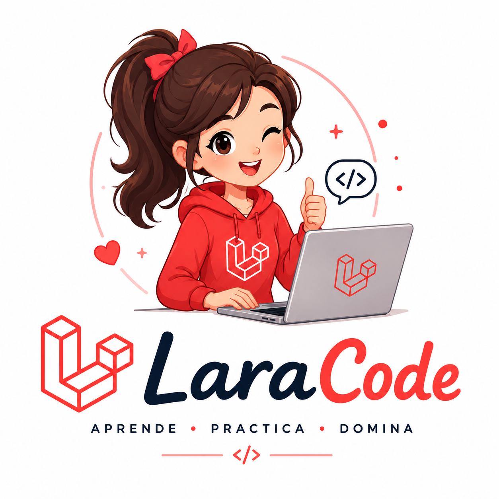

<div align="center">
  

  # LaraCode

  **Aprende Laravel programando.**

  Proyecto educativo full stack construido paso a paso con Laravel, Vue, Inertia y Tailwind CSS.
</div>

---

## Sobre el proyecto

LaraCode tiene un doble propósito: aprender desarrollo full stack de forma práctica y construir progresivamente una plataforma que ayude a otras personas a aprender Laravel. No es una demostración generada de una sola vez; cada funcionalidad se estudia, diseña, implementa y prueba como una tarea independiente.

El proyecto es personal y está pensado para reflejar una evolución profesional: decisiones documentadas, alcance controlado, commits intencionales y calidad verificable.

## Estado actual

**Base VILT existente; dominio educativo todavía sin implementar.**

- Stack VILT instalado y funcionando.
- Autenticación oficial con registro, login y recuperación de contraseña.
- MySQL previsto en configuración; tests aislados con SQLite en memoria.
- Welcome personalizada con la identidad de LaraCode.
- Tests, formato, lint, análisis estático y build configurados.
- Laravel Boost integrado para que Codex actúe como mentor técnico.

Todavía no se han implementado cursos, lecciones, ejercicios, progreso ni gamificación.

## Stack

| Tecnología | Función |
| --- | --- |
| PHP 8.4 y Laravel 13 | Backend, rutas, autenticación, Eloquent y lógica de aplicación |
| Vue 3 y TypeScript | Interfaz mediante Composition API y `<script setup>` |
| Inertia 3 | Comunicación entre Laravel y Vue sin una API separada |
| Tailwind CSS 4 | Diseño responsive y sistema visual |
| Vite 8 | Desarrollo y compilación del frontend |
| MySQL 8 | Persistencia en desarrollo |
| Pest 4 | Tests automatizados |
| Pint, ESLint, Prettier y Larastan | Formato y calidad de código |
| Laravel Boost | Contexto y herramientas Laravel para Codex |

## Arquitectura

```text
Navegador
   ↓
Vue + TypeScript
   ↓
Inertia
   ↓
Rutas, middleware y controladores de Laravel
   ↓
Eloquent
   ↓
MySQL
```

LaraCode es un monolito Laravel con Inertia. Las páginas normales no utilizan una API REST separada.

## Instalación local

### Requisitos

- PHP 8.3 o superior.
- Composer 2.
- Node.js y npm compatibles con Vite 8.
- MySQL 8 o compatible.

### Preparación

```bash
git clone git@github.com:CarloSol-90/LaraCode.git
cd LaraCode
composer install
npm install
```

En Windows:

```powershell
Copy-Item .env.example .env
php artisan key:generate
```

Configura las credenciales de MySQL en `.env`, crea una base llamada `laracode` y ejecuta:

```bash
php artisan migrate
npm run build
```

## Desarrollo

Con Laragon, inicia Apache y MySQL y abre:

```text
http://laracode.test
```

Para recompilación automática del frontend:

```bash
npm run dev
```

También se puede iniciar todo mediante el comando combinado:

```bash
composer run dev
```

## Calidad

```bash
php artisan test
vendor/bin/pint
npm run lint:check
npm run format:check
npm run types:check
npm run build
```

## Trabajo por tareas

El desarrollo se organiza mediante tareas pequeñas, numeradas y verificables:

1. Consultar el índice en [`docs/TASKS.md`](docs/TASKS.md).
2. Crear un plan en `docs/tasks/NNN-descripcion.md` antes de implementar.
3. Trabajar en una rama `NNN-short-english-description`, comenzando siempre por el número del plan y usando inglés.
4. Ejecutar las comprobaciones relacionadas.
5. Actualizar el estado y el diario de desarrollo.
6. Integrar la tarea solo cuando sus criterios de aceptación estén completos.

## Documentación

- [Visión del proyecto](docs/PROJECT_BRIEF.md)
- [Arquitectura](docs/ARCHITECTURE.md)
- [Plan de aprendizaje](docs/LEARNING_PLAN.md)
- [Hoja de ruta](docs/ROADMAP.md)
- [Decisiones](docs/DECISIONS.md)
- [Diario de desarrollo](docs/DEV_JOURNAL.md)
- [Índice de tareas](docs/TASKS.md)
- [Glosario y guía práctica de código](docs/GLOSSARY.md)

## Filosofía educativa

Codex actúa como mentor: explica los conceptos, propone pasos pequeños, revisa el código y ofrece pistas progresivas. El código funcional se construye con participación directa del autor para priorizar comprensión sobre velocidad.

## Próximo paso

> Revisar el plan maestro y retomar la tarea 004: persistencia de la primera ruta de aprendizaje, sin añadir todavía interfaz. El recorrido VILT ya se registró en la tarea 003.

## Autor

Proyecto personal de [Carlos Soler](https://github.com/CarloSol-90).

## Plan maestro

La plataforma prevista combina formación estructurada, casos profesionales, siete formatos de ejercicios, evaluación adaptativa de cinco niveles y dominio 0–100 por habilidad. El MVP incluye LaraCodepedia gratuita, entrevistas técnicas, pruebas prácticas y gamificación básica. Nada de ello está implementado aún.

Monolito modular como dirección, conservando las carpetas Laravel existentes. Exercises produce evidencia; Assessment estima dominio y recomienda práctica. Free/Pro y AWS quedan para después del MVP. Los nombres exactos de los siete formatos son una propuesta pendiente de validar; la fórmula adaptativa aún no está definida.

- [Auditoría del código](docs/AUDIT.md)
- [Fuentes oficiales y versiones](docs/OFFICIAL_DOCS.md)
- [Verificaciones de esta actualización](docs/VALIDATION.md)

El contrato completo del MVP está en PROJECT_BRIEF y su secuencia en ROADMAP. No se crea infraestructura ni funcionalidad de dominio en esta actualización. Los PR requieren revisión; no hacer merge a main sin aprobación.
